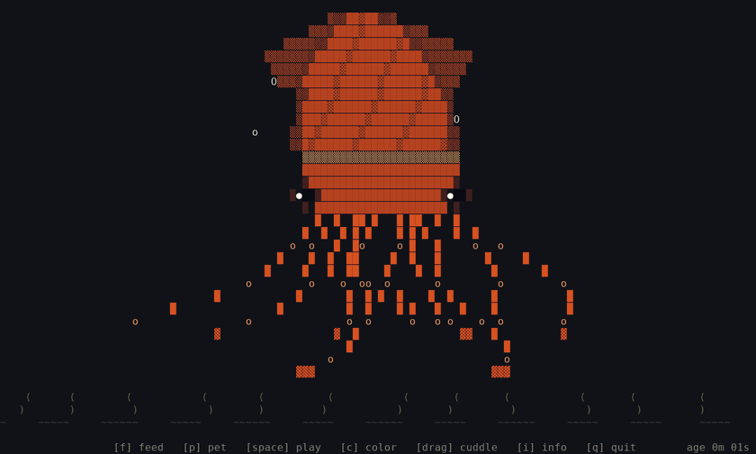
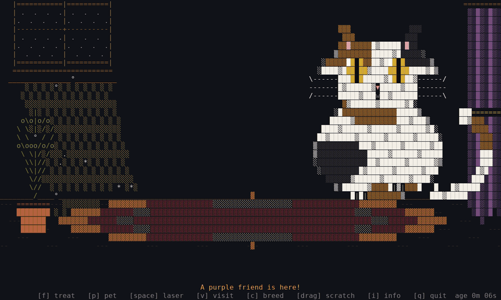

# terminal-pet 🐾

<p align="center">
  
</p>

Three full-screen, colored ASCII pets for your terminal: a giant squid, a cat in a cozy room and a dog in a backyard. You can feed them, pet them, play with them, and boop them with the mouse. It's written in Rust with [ratatui](https://ratatui.rs), and the default squid color is based on photos of real giant squid. Nothing is saved between runs.

Pets in different terminals on the same computer find each other and visit. A cat that plays sends a squid a toy mouse, a squid that plays can ink the cat, and a dog's bark startles both.

<p align="center">
  
</p>

## Quickstart 🚀

Requires Rust (install it with [rustup](https://rustup.rs)).

```
git clone https://github.com/Gidntsquia/terminal-pet
cd terminal-pet
cargo install --path .   # Installs the terminal-pet binary
terminal-pet             # The squid (same as terminal-pet --pet squid)
terminal-pet --pet cat   # The cat
terminal-pet --pet dog   # The dog
```

Press `f` to feed, `p` to pet, `space` to play, `c` to change color or breed, `v` to visit another pet, `i` to open the info card, and `q` to quit. Click a pet to boop it, drag across it to cuddle (squid), scratch (cat) or scritch (dog) it, and scroll over it to ruffle it.

On Linux x86_64 you can skip Rust and download a prebuilt binary from the [releases page](https://github.com/Gidntsquia/terminal-pet/releases).

Other commands:

```
terminal-pet --pet cat --breed siamese   # Also tabby, calico, tuxedo, maine-coon, persian and more
terminal-pet --pet dog --breed corgi     # Also golden, husky, dalmatian, dachshund, bluey, bingo and more
terminal-pet --color purple              # Squid color: also blue, pink, gold, ghost, blue-ringed and more
terminal-pet --solo                      # Don't look for other pets
```

## Features 🔬

- The pet is drawn to fit the window and is redrawn when you resize it.
- The squid's tentacles sway and its eyes blink while bubbles drift up past seaweed. Feeding drops a fish for it to grab.
- The cat bats treats, chases a laser dot, purrs when stroked, and swings its tail as your mouse crosses it.
- The dog catches biscuits, fetches a ball, digs, naps and barks.
- Cats come in 12 breeds, dogs in 11 and squid in eight colors. Press `c` to change while it runs.
- Pets visit each other on their own every so often, or when you press `v`, and play chase, high-five and tag.
- A squid that gets a toy mouse from a cat jumps and puffs up. A cat that gets inked sneezes it off. A dog's bark makes a cat arch and a squid jet away.
- Pressing feed, pet and play together or repeatedly layers the reactions.
- The `i` card shows the pet's age and this session's feeds, pets and boops.
- Uses truecolor when the terminal supports it and falls back to 256 colors. `--ascii` and `NO_COLOR=1` work too.

## Documentation 📚

More details in the
[wiki](https://github.com/Gidntsquia/terminal-pet/wiki):

- [Home](https://github.com/Gidntsquia/terminal-pet/wiki/Home) — index of all pages
- [Squid](https://github.com/Gidntsquia/terminal-pet/wiki/Squid) — keys, mouse, colors
- [Cat](https://github.com/Gidntsquia/terminal-pet/wiki/Cat) — keys, mouse, breeds
- [Dog](https://github.com/Gidntsquia/terminal-pet/wiki/Dog) — keys, mouse, breeds
- [Visits](https://github.com/Gidntsquia/terminal-pet/wiki/Visits) — finding neighbors, games, messages
- [Controls](https://github.com/Gidntsquia/terminal-pet/wiki/Controls) — every key, gesture and flag
- [Breed Gallery](https://github.com/Gidntsquia/terminal-pet/wiki/Breed-Gallery) — every breed and color
- [Adding a pet](https://github.com/Gidntsquia/terminal-pet/wiki/Adding-a-pet) — checklist for new pets
- [Development](https://github.com/Gidntsquia/terminal-pet/wiki/Development) — build, tests, code layout

## License 📄

[MIT](LICENSE).
