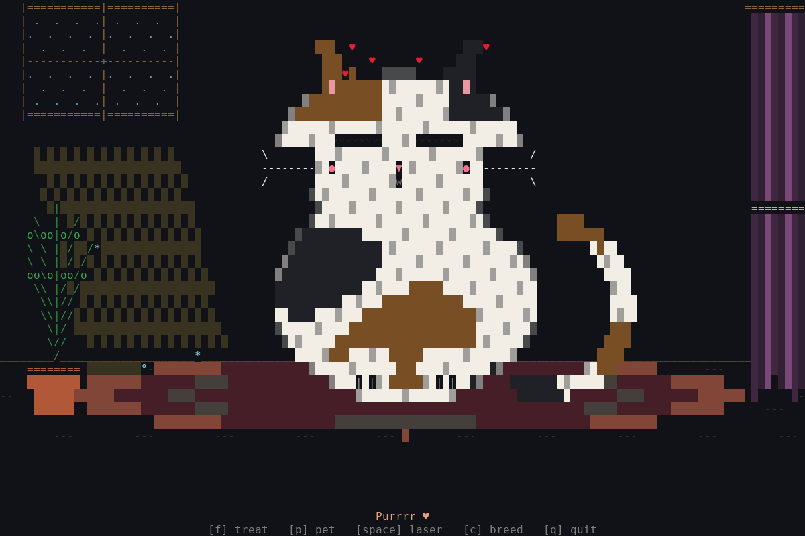
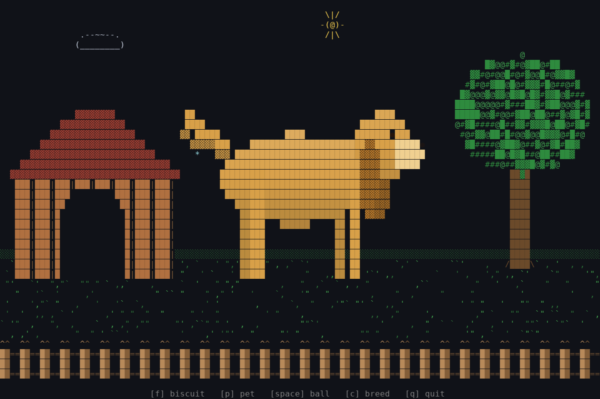
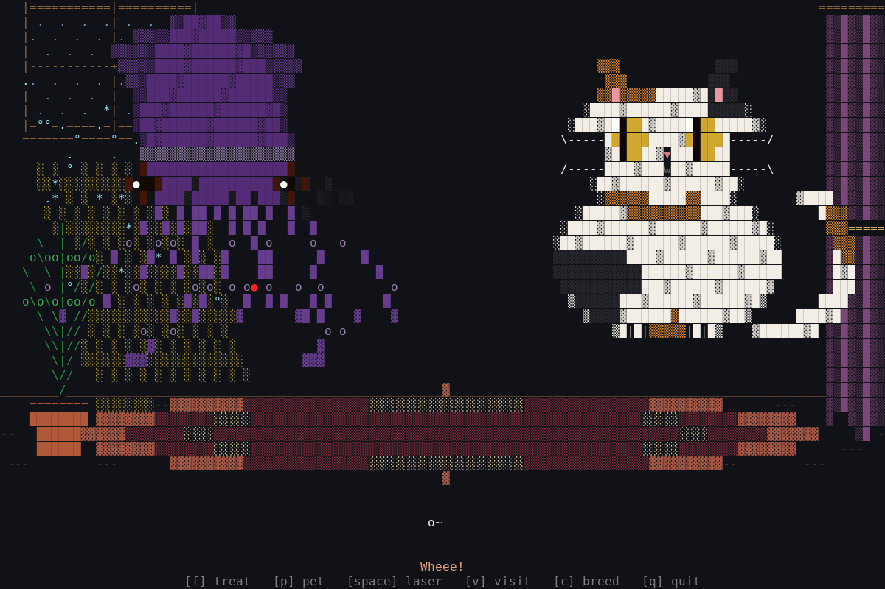

# terminal-pet 🦑🐈🐕

<p align="center">
  
  
  
</p>

Three full-screen, colored ASCII pets for your terminal: a giant squid, a cat with 12 breeds in a cozy room, and a dog with 11 breeds in a backyard (`--pet dog`). You can feed them, pet them, play with them, and boop them with the mouse. It's written in Rust with [ratatui](https://ratatui.rs), and the default squid color is based on photos of real giant squid. Nothing is saved between runs.

Pets in different terminals on the same computer find each other and visit. A cat that plays sends a squid a toy mouse, and a squid that plays can ink the cat.

<p align="center">
  
</p>

## Quickstart 🚀

Requires Rust (install it with [rustup](https://rustup.rs)).

```
git clone https://github.com/Gidntsquia/terminal-pet
cd terminal-pet
cargo install --path .   # Installs the terminal-pet binary
terminal-pet --pet cat   # The cat
terminal-pet            # The squid (same as terminal-pet --pet squid)
```

Press `f` to feed, `p` to pet, `space` to play, `c` to change color or breed, `v` to visit another pet, `i` to open the info card (age and this session's feeds, pets, boops, ruffle and drag seconds; nothing is saved), and `q` to quit. Click a pet to boop it, drag across it to cuddle (squid), scratch (cat) or scritch (dog) it, and scroll over it to ruffle it.

On Linux x86_64 you can skip Rust and download a prebuilt binary from the [releases page](https://github.com/Gidntsquia/terminal-pet/releases).

Other commands:

```
terminal-pet --pet cat --breed siamese   # Also tabby, black, calico, orange, tuxedo, gray, white and more
terminal-pet --color purple                 # Also red, blue, pink, green, gold, ghost, blue-ringed
terminal-pet --ascii                        # Draws without Unicode glyphs
terminal-pet --solo                         # Don't look for other pets
terminal-pet --pet dog --nap                # Dog starts asleep in the doghouse (ignored for other pets)
terminal-pet --no-mouse                     # Don't capture the mouse
terminal-pet --seed 42                      # Same random behavior every run
NO_COLOR=1 terminal-pet                     # Monochrome
```

## Features 🔬

- The squid is drawn to fit the window and is redrawn when you resize it.
- Tentacles sway, the body bobs, the eyes blink, and bubbles drift up past seaweed and waves.
- Feeding drops a fish for the squid to grab, and petting sends hearts floating up.
- The cat bats treats, chases a laser dot, purrs when stroked, and swings its tail as your mouse crosses it.
- The dog catches biscuits, fetches a ball, digs, naps in its doghouse and barks. Pick one of its 11 breeds (including dachshund, bluey and bingo) with `--pet dog --breed <name>`.
- Cats come in 12 breeds and squid in eight colors. Press `c` to change while it runs.
- Pets visit each other every 20-30 minutes, or when you press `v`, and play chase, high-five and tag.
- A squid that gets a toy mouse from a cat jumps and puffs up. A cat that gets inked sneezes it off. A dog's bark makes a cat arch and a squid jet away.
- Feed, pet and play stack: pressing them together or repeatedly layers the reactions.
- Uses truecolor when the terminal supports it and falls back to 256 colors.

## Documentation 📚

More details in the
[wiki](https://github.com/Gidntsquia/terminal-pet/wiki):

- [Home](https://github.com/Gidntsquia/terminal-pet/wiki/Home) — index of all pages
- [Squid](https://github.com/Gidntsquia/terminal-pet/wiki/Squid) — keys, mouse, colors
- [Cat](https://github.com/Gidntsquia/terminal-pet/wiki/Cat) — keys, mouse, breeds
- [Dog](https://github.com/Gidntsquia/terminal-pet/wiki/Dog) — keys, mouse, breeds
- [Adding a pet](https://github.com/Gidntsquia/terminal-pet/wiki/Adding-a-pet) — checklist for new pets
- [Visits](https://github.com/Gidntsquia/terminal-pet/wiki/Visits) — finding neighbors, games, messages
- [Controls](https://github.com/Gidntsquia/terminal-pet/wiki/Controls) — every key and gesture
- [Development](https://github.com/Gidntsquia/terminal-pet/wiki/Development) — build, tests, code layout
- [Breed Gallery](https://github.com/Gidntsquia/terminal-pet/wiki/Breed-Gallery) — every cat and squid color

## License 📄

[MIT](LICENSE).
