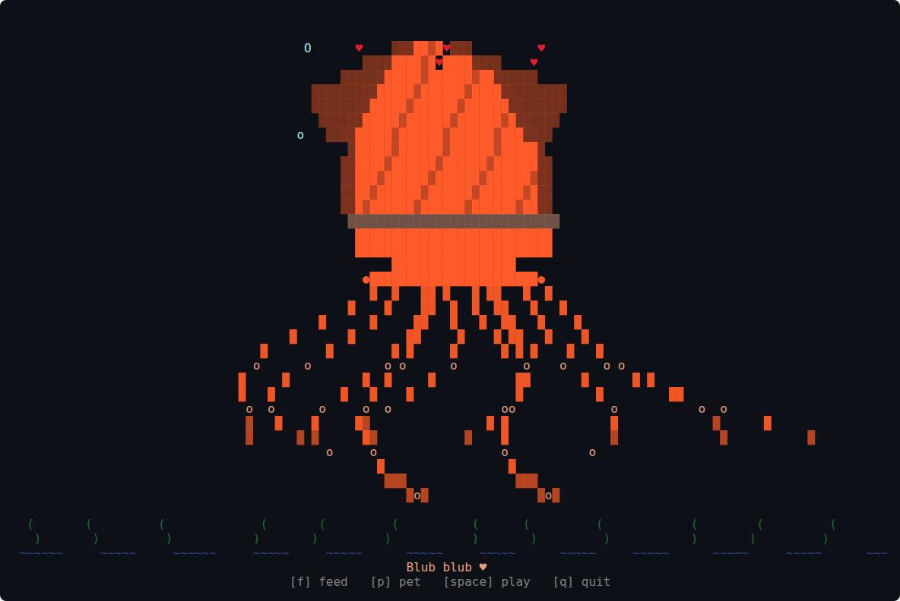

# squid-pet 🦑

<p align="center">
  
</p>

A full-screen, colored ASCII giant squid pet for your terminal. It fills the window, sways, blinks, and blows bubbles, and you can feed it, pet it, and play with it. It's written in Rust with [ratatui](https://ratatui.rs), and the default red is based on photos of real giant squid. Nothing is saved between runs.

## Quickstart 🚀

Requires Rust (install it with [rustup](https://rustup.rs)).

```
git clone https://github.com/Gidntsquia/squid-pet
cd squid-pet
cargo install --path .   # Builds the release binary and puts squid-pet on your PATH
squid-pet
```

Press `f` to feed, `p` to pet, `space` to play, `c` to fade to the next color, `v` to send your squid to visit another squid-pet, and `q`, `Esc` or Ctrl-C to quit.

On Linux x86_64 you can skip Rust and download a prebuilt binary from the [releases page](https://github.com/Gidntsquia/squid-pet/releases).

Other commands:

```
squid-pet --ascii      # Draws without Unicode glyphs
squid-pet --solo       # Don't look for other squid-pets
squid-pet --seed 42    # Same random behavior every run
squid-pet --color purple   # red, purple, blue, pink, green, gold, ghost, blue-ringed
squid-pet --color random   # Picks a color at launch (respects --seed)
NO_COLOR=1 squid-pet   # Monochrome
```

## Features 🔬

- The squid is drawn procedurally to fit the window and is redrawn when you resize it.
- Tentacles sway, the body bobs, the eyes blink, and bubbles drift up past seaweed and waves.
- The squid rests, then swims sideways in short bursts to a new spot.
- Feeding drops a small fish from the top of the screen; the tentacles grab it and the squid puffs up.
- Petting closes its eyes, makes it blush, and sends hearts floating up.
- Playing makes it squirt an ink cloud and dart around the screen.
- Every so often it yawns, looks around, or lets out a small ink puff on its own.
- Comes in eight colors. Pick one with `--color`, or press `c` to fade to the next one while it runs.
- Several squid-pets on the same computer find each other automatically (no network, no setup; `--solo` turns it off).
- Visits: press `v`, or wait 20–30 minutes, and your squid swims out the side of its terminal and shows up in another one in its own colors. It plays there for about 20 seconds (chase, tentacle high-five, ink tag, color flash chat), then swims home. Your terminal shows empty water meanwhile. Press `v` again to call it back. After a visit, squids don't start another on their own for 10 minutes.
- Messages: a fed squid sometimes tosses a fish to a neighbor, squids blow bubble streams across to each other, and playing sends a little ink puff.
- Feed, pet and play stack: pressing them together or repeatedly layers the reactions, adding more and lasting longer.
- Uses truecolor when the terminal supports it and falls back to 256 colors.

## Documentation 📚

- [Development](docs/Development.md) — code layout, building, releases, tests

## License 📄

[MIT](LICENSE).
